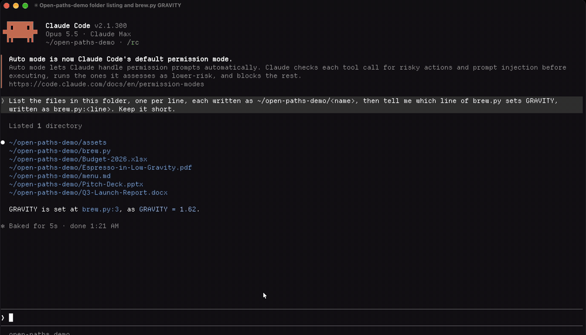

# open-paths

**Click a file path in Claude Code, and the file opens in its app.**

Claude writes `~/Desktop/Report.docx`. You Cmd+click it. Word opens. A PDF opens in Preview, a spreadsheet in Excel, `app.py:42` in VS Code at line 42.

Out of the box, Claude Code's fullscreen renderer answers a click on a file path by showing the file in your file manager, not opening it ([fullscreen docs](https://code.claude.com/docs/en/fullscreen#use-the-mouse); see also [#71658](https://github.com/anthropics/claude-code/issues/71658)), and paths in Claude's replies are often not links at all. open-paths turns every path Claude writes into a link that opens the file itself.



## Install

At the prompt of a Claude Code session:

```text
/plugin install open-paths --marketplace kiankhooban/open-paths
```

Answer `y` to add the marketplace, pick a scope, and it is active at once. From a shell:

```bash
claude plugin install open-paths --marketplace kiankhooban/open-paths
```

## What opens where

| You click | It opens in |
|---|---|
| `.docx` `.pdf` `.xlsx` `.pptx` `.png` `.csv` `.html` and every other document | the file type's default app |
| `.py` `.java` `.ts` `.c` `.go` `.rs` `.json` `.md` and 100+ other code and text types | your editor (VS Code by default), at the line when one is written: `app.py:42`, `main.c:10:5` |
| a folder | Finder, Explorer or your file manager |
| `.sh` `.command` `.ps1` and other scripts | your editor, never their default app: opened by a terminal, a script runs |
| `.app` `.pkg` `.dmg` `.exe`, and any type not on the lists above | revealed in the file manager, never launched |

## What it links

- Absolute paths, `~/` paths and paths relative to Claude's working directory.
- Paths in backticks, including ones with spaces: `` `~/My Drive/Notes Q1.docx` ``.
- `file:line` and `file:line:col`.
- Paths inside code blocks get a `↳ open` row under the block, so the code stays copyable.
- Bare file names Claude mentions after its tools touched them: Claude writes `~/output/Report.docx`, later says "see Report.docx", and that name opens the right file.
- `Write` tool rows get an `⎿ open` line under them (`/open-paths tools all` adds Read and Edit).

Only paths that exist become links, checked against the file system with a short cache, so a made-up or stale path stays plain text.

## Settings

Run `/open-paths` to see the current settings.

```text
/open-paths editor cursor              vscode, cursor, zed, sublime, idea, default, or any app name
/open-paths set pdf Skim               send a file type to an app
/open-paths set txt editor             ... or to the editor, the default app, or a reveal
/open-paths unset pdf                  back to the built-in rule
/open-paths folders editor             folders open in the editor instead of the file manager
/open-paths tools all|write|off        open lines under tool rows
/open-paths toast off                  no "Opening Report.docx" toast
/open-paths mode inline|auto|below|off how links are drawn (below)
```

A script or launcher type cannot be sent to its default app or another app, only to the editor or a reveal.

## Works with other mods

Mods that redraw Claude's replies (themes, markdown viewers, math renderers) and open-paths both want to draw the same reply. The default `inline` mode draws replies that contain paths itself, so the links sit in the text. `auto` keeps another mod's drawing whole and adds a dim `↳ open` row of links under it; `below` always uses the row.

## Platforms

Supports macOS (`open`), Linux (`xdg-open`), Windows (`start`, Explorer) and WSL (`wslview`, or Explorer with the path translated by `wslpath`).

In Claude Code's fullscreen renderer the mod answers the click itself. In the classic renderer the terminal follows the link: documents go as `file://` links, code goes through your editor's URL scheme (`vscode://file/...:42`), and launchers and scripts get no terminal link at all.

## Safety

Claude's replies can be steered by text it reads (a web page, a file), so open-paths treats every path in a reply as untrusted:

- **Allow-list, not deny-list.** Only known document and media types go to their default app. Code goes to your editor. Everything else is revealed in the file manager, so a type nobody thought of cannot launch.
- **Real paths.** Every symlink is followed before deciding: a link named `report.pdf` that leads to an app is revealed, not opened.
- **No shell.** Commands run by argument vector. On Windows, documents open through Explorer; a file name holding characters `cmd.exe` would act on (`& | ^ % !`) is refused, not passed on.
- **No network paths.** Paths that land on a network share are never linked: opening one can send credentials to its host.
- **Nothing on an unknown system.** If the platform cannot be identified, nothing opens.

Two limits worth knowing: `.html` and `.svg` open in your browser, which runs their scripts exactly as a double-click would; and a file swapped for another in the instant between the click and the open is opened as whatever it now is, as with any opener.

## What it reads, runs and sends

**Sends: nothing.** open-paths makes no network calls. Nothing leaves your machine; the only thing that ever leaves the mod is a file path, handed as an argument to a local program when you click.

**Hooks**, all in `hooks/register.tsx`:

| Hook | What it does |
|---|---|
| `ui.render` on `AssistantMessage` | Finds paths in a reply, checks they exist, and draws the reply with those paths as links the mod answers. The stored conversation is not changed. |
| `ui.render` on `ToolUse` | Adds an `⎿ open` line under Write (or Read/Write/Edit) tool rows. |
| `tool.call` | After a Read, Write, Edit or NotebookEdit call, remembers the file's path so a bare name in a later reply finds it. It never blocks, changes or reruns a tool call. |
| `session.start` | Loads settings and registers the `/open-paths` command. |
| `command.run` for `/open-paths` | Shows or changes the settings. |

**Reads:** file metadata only (`$.fs.stat`: does the path exist, is it a file or folder, where does a symlink lead); the session's working directory; the environment variables `HOME` / `USERPROFILE` (your home folder, to expand `~`) and `OS` (to recognise Windows). No credentials, tokens or file contents.

**Stores** (in the mod's own `$.store`, on your machine): your `/open-paths` settings, and the list of file paths Claude's tools touched, capped at 500 names.

**Runs**, by argument vector with no shell, and only these programs:

| Program | When | Why |
|---|---|---|
| `uname -sr` | once per session, on the first click | to tell macOS, Linux and WSL apart |
| `open <file>`, `open -a <app> <file>`, `open -R <file>`, `open -t <file>` | on a click, macOS | open in the default app, a chosen app, reveal in Finder, or the plain text editor |
| `xdg-open <file or folder>` | on a click, Linux | open in the default app, or show the folder |
| `explorer.exe <file>`, `explorer.exe /select,<file>` | on a click, Windows and WSL | open in the default app, or reveal |
| `wslview <file>`, `wslpath -w <file>` | on a click, WSL | open through Windows, and translate the path for it |
| `code -g`, `cursor -g`, `zed`, `subl`, `idea --line` | on a click on code, if that editor is chosen | open the editor at the line |
| `cmd /c <editor command> <file>` | on a click on code, Windows | editor launchers there are `.cmd` files; a name `cmd.exe` would act on is refused first |

`<file>` is always the real path of a file that exists, after the Safety rules above. `<app>` is an app you named yourself with `/open-paths set` or `/open-paths editor`.

## How it works

A `ui.render` hook on assistant messages finds the paths, resolves them against the session's working directory and home, checks they exist, and draws the reply as markdown whose links the mod answers (`onLinkPress`). A click runs one command, by argument vector with no shell: `open`, `xdg-open`, `cmd /c start`, or your editor's command line. Nothing leaves your machine, and the stored conversation is never changed: only its drawing carries the links.

## Development

```bash
git clone https://github.com/kiankhooban/open-paths
claude --plugin-dir ./open-paths      # a session with the mod loaded, reloading as you edit
claude plugin validate ./open-paths
claude plugin test ./open-paths       # the tests, run by Claude Code's own engine
```

## License

MIT
